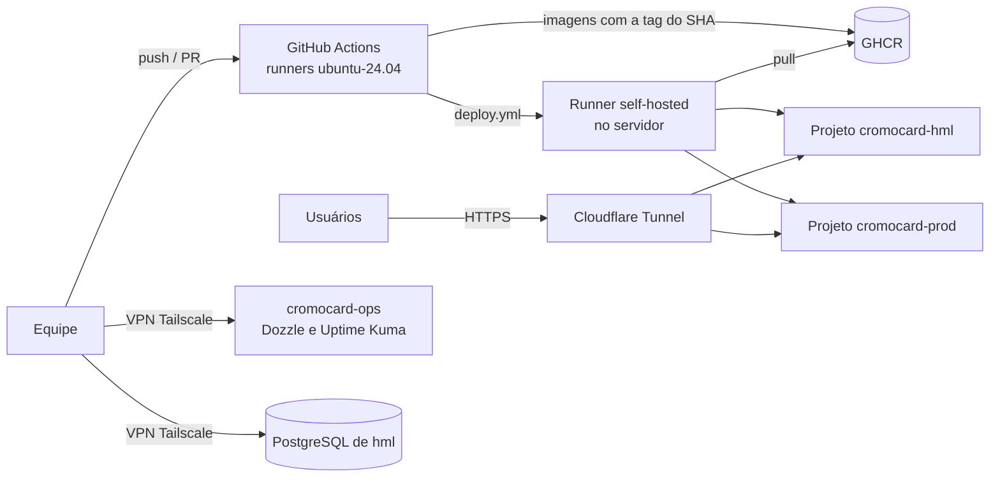

# Infraestrutura do CromoCard

Ponto de entrada da infraestrutura: onde o sistema roda, como o código chega lá e onde está cada
documento. As decisões (o porquê) estão no [ADR-055](../ADR/ADR-055-topologia-de-ambientes-e-implantacao.md).

> [!IMPORTANT]
> Este repositório é **público**. Nenhum documento daqui guarda valores de segredo, IPs, e-mails ou nomes de
> contas do servidor. Segredos ficam nos Environments do GitHub e no cofre da equipe (Bitwarden).

## Situação em 23/10/2026

| Área | Situação |
|---|---|
| Homologação | No ar desde 15/10, sem o frontend (a imagem `web` ainda não existe). Todo merge na `develop` do backend implanta sozinho |
| Produção | Nunca publicada: a `main` do backend só tem o commit inicial |
| CI | Verde. Runners fixados em `ubuntu-24.04` em revisão (PR #10 do backend) |
| Proteção de branch | Rulesets na `develop` e na `main` do backend desde 23/10: PR, 1 aprovação e CI verde |
| Observabilidade | Dozzle e Uptime Kuma pela VPN. **Sem alertas automáticos** (decisão de 23/10): falhas aparecem no Actions e no painel do Kuma |
| Backup | Diário, criptografado, com cópia externa; a restauração ainda não foi testada |

Detalhes em [topologia.md](topologia.md).

## Visão geral

- **Nada entra pelo roteador.** O tráfego público chega pelo Cloudflare Tunnel (conexão de saída do
  servidor); a equipe chega pelo Tailscale.
- **O servidor não compila.** O CI faz o build, o scan (Trivy e gitleaks) e publica no GHCR; o servidor só
  baixa a imagem e sobe.
- **Homologação e produção são projetos Compose separados**, cada um com rede, banco e `.env` próprios.

## Como o código chega aos ambientes

| Evento no backend | Ambiente | Aprovação |
|---|---|---|
| Merge na `develop` (com CI verde) | Homologação | Só a do PR |
| Merge `develop → main` com *Create a merge commit* | Produção, com a mesma imagem de homologação | PR + revisor do Environment `prod` |
| *Actions → deploy → Run workflow* | O escolhido (rollback manual) | Em produção, sim |

O passo a passo está nos [runbooks](runbooks.md#deploy).

## Documentos

| Documento | Para quê |
|---|---|
| [ADR-055](../ADR/ADR-055-topologia-de-ambientes-e-implantacao.md) | Decisões de topologia e implantação, e o porquê |
| [topologia.md](topologia.md) | Estado atual: servidor, ambientes, rede, GitHub, observabilidade e backup |
| [runbooks.md](runbooks.md) | Como operar: saúde, deploy, rollback, falhas, segredos, backup, runner |
| [historico.md](historico.md) | O que foi feito, quando e por quem, com a evidência |

No repositório do backend (`apps/cromocard-backend`), onde fica o código da infraestrutura:

| Arquivo | Para quê |
|---|---|
| `infra/` e `infra/README.md` | Arquivos Compose de cada ambiente e do projeto ops |
| `.github/workflows/` | `ci.yml`, `deploy.yml`, `compose-validate.yml`, `env-check.yml` |
| `docs/ONBOARDING.md` | Primeiro acesso de quem entra na equipe (VPN, banco de hml, deploy) |
| `docs/runbooks/segredos.md` | Onde cada segredo fica e como trocar |
| `docs/runbooks/observabilidade.md` | Instalação do projeto ops e monitores do Uptime Kuma |

## Quem faz o quê

| Área | Responsável |
|---|---|
| Servidor, rede, VPN, backup e segurança dos repositórios | Lucas |
| Pipeline (CI e deploy), Compose e observabilidade | Duarte |
| Repositórios, branches e aprovação de produção | Daniel (PO), com o Lucas |

Para pedir acesso à VPN ou ao banco de homologação, siga o `docs/ONBOARDING.md` do backend. SSH no servidor
é só para a infraestrutura.

## Regras que valem para todo mundo

- Toda mudança na `develop` e na `main` do backend entra por PR, com 1 aprovação e CI verde.
- Release para produção só com *Create a merge commit*: o deploy usa o segundo pai do merge.
- Nenhum serviço publica porta (`ports:`) no Compose.
- Banco de homologação só com dados fictícios (LGPD). Nunca restaurar dump de produção em hml.
- Nunca `docker compose down -v` em homologação nem no projeto ops: apaga o banco, a identidade na VPN e os
  monitores.
- Segredo vazado: rotacionar primeiro, avisar a equipe, só depois limpar o rastro.
- Não há alertas automáticos: depois de um merge na `develop`, quem fez o merge confere o job *Deploy em hml*
  no Actions.
