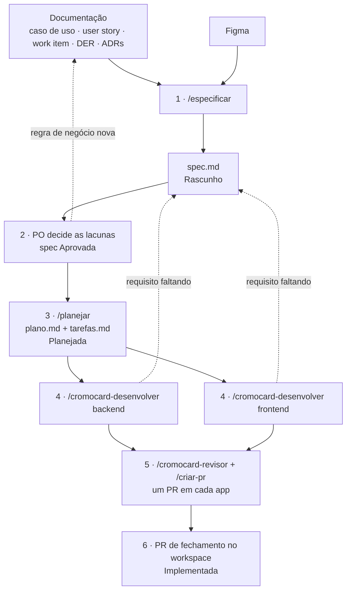

# Specs — desenvolvimento orientado a especificação (SDD)

Uma spec é o combinado de **uma user story** (`CCDnnn`) antes de virar código: o que fazer, como e em que ordem.
Ela não inventa requisito. Junta num lugar só, com IDs fixos, o que já está no caso de uso, na user story, no work
item, no DER e no Figma, e acrescenta o que falta para implementar e conferir: critérios de aceite, contrato da API
e tarefas (ADR-047).

Hierarquia das fontes: **documentação** (casos de uso, user stories, DER, ADRs) → **spec** → **código**. O Figma
manda no visual, e o objetivo é ser o mais fiel possível a ele. Cada diferença entre os dois vira uma pergunta: o que só
existe no Figma recebe "faz sentido implementar?", e, se sim, a documentação é ajustada antes do código. Até haver
decisão, vale a documentação.

As specs ficam aqui, fora de `docs/`, porque `docs/` é a fonte da verdade e só guarda documentação. A spec é
derivada dela e muda de status e de progresso ao longo do trabalho.

## Fluxo



| Passo | Quem | Como | Sai | Status |
|---|---|---|---|---|
| 1. Especificar | quem pegou a user story | `/especificar CCDnnn [link do frame]` | `spec.md` com requisitos, critérios de aceite, telas e lacunas | `Rascunho` |
| 2. Aprovar | PO | revisa o PR da spec e decide as lacunas | lacunas decididas; caso de uso atualizado se a regra mudou | `Aprovada` |
| 3. Planejar | devs do back e do front, juntos | `/planejar CCDnnn` | `plano.md` (contrato da API) e `tarefas.md`; Tasks no Azure, se quiser | `Planejada` |
| 4. Implementar | dev de cada app, em paralelo | `/cromocard-desenvolver faça esta spec "CCDnnn" backend` · `… frontend` | código e testes na branch de feature de cada app | `Em implementação` |
| 5. Revisar e abrir o PR | quem implementou | `/cromocard-revisor` · `/criar-pr` | um PR em cada app, citando os requisitos | — |
| 6. Fechar | quem implementou | `/criar-pr workspace` | ponteiros `apps/*` atualizados e tarefas marcadas | `Implementada` |

### 1. Especificar — `/especificar CCDnnn [link do frame]`

- **Entra:** o código do caso de uso (`CCD014`) ou o work item (`#120`). O link do frame é opcional: sem ele, a
  skill procura a tela no índice do `/analisar-figma-chrome`.
- **O que acontece:**
  1. O agent `analista-requisitos` lê o caso de uso, a user story, o work item no Azure, o DER e os ADRs que mudam a
     regra. Ele devolve os requisitos (`R1`, `R2`…), cada um com a origem (`14-marcar-carta-como-possuo.md, FP 3`).
  2. O agent `leitor-figma` abre as telas no Chrome, no modo protótipo, e faz o inventário delas. Não gasta a cota do
     MCP do Figma.
  3. A skill cruza os dois e grava o `spec.md`: requisitos, critérios de aceite (`CA1`… em Dado/quando/então), dados
     do DER, telas com o veredito, o que fica fora do escopo e as lacunas (`L1`…).
- **Sai:** a spec em `Rascunho`, a linha no índice, a lista de lacunas para o PO e as divergências do Figma para o
  designer.
- **Git:** branch `docs/<id>-spec-<descricao>` no workspace, commit `docs(specs): especifica CCDnnn <nome>` com
  `AB#<id>` e PR para `development`.

### 2. Aprovar — PO

- O PO lê a spec no PR do workspace e responde cada lacuna.
- **Regra de negócio** decidida (ex.: "pode marcar Possuo com quantidade zero?"): o caso de uso é atualizado no mesmo
  PR, e o requisito passa a citar o passo novo. **Decisão técnica:** vira ADR `Proposto`.
- **Diferença com o Figma** é decidida aqui, como lacuna. Se o que só existe no Figma fizer sentido, o caso de uso é
  atualizado no mesmo PR.
- Quando não sobra lacuna `pendente`, avise o Claude ("o PO aprovou a spec do CCD014"). A spec fica `Aprovada`, com
  a data e quem aprovou. O Claude nunca aprova sozinho.

### 3. Planejar — `/planejar CCDnnn`

- **Entra:** a spec `Aprovada`. Em `Rascunho`, a skill para e mostra o que falta.
- **O que acontece:** a skill lê o DBML e o `schema.prisma` para achar as tabelas que ainda não têm migration. Lê
  também o domínio e a feature do código, os modelos `users` dos dois apps, as outras specs (dependências) e os ADRs.
  Com isso escreve:
  - `plano.md`: tabelas e migrations, **contrato da API** (endpoint, acesso, entrada, resposta e erros, no padrão do
    ADR-011), arquivos do backend e do frontend, e um teste para cada `CA`;
  - `tarefas.md`: tarefas `T1`… em ordem, separadas por app, cada uma com os requisitos que cobre e um "Pronto quando".
- **Azure:** a skill oferece criar as tarefas como Tasks filhas da user story, com confirmação, e grava o `AB#` de
  cada uma no `tarefas.md`.
- **Sai:** a spec `Planejada`. O contrato da API é o combinado entre quem faz o back e quem faz o front; ele é revisado
  no PR do workspace (o mesmo da spec ou outro).

### 4. Implementar — `/cromocard-desenvolver faça esta spec "CCDnnn" [backend|frontend]`

- **Entra:** a spec. O frontend não precisa esperar o backend: ele segue o contrato do plano.
- **O que acontece:** a skill compara o Figma com a documentação e pergunta cada diferença, ajusta a documentação e a spec
  e, sem pendências, cria `feature/<id>-<descricao>` a partir de `develop` e faz as tarefas em ordem. Em cada tarefa ela
  copia o padrão do modelo `users`, implementa só o que a tarefa diz, escreve os testes com o ID do critério no nome
  (`CA2: recusa senha incorreta com 401`), roda lint, typecheck e testes, e marca `[x]`. Se você autorizar, ela commita ao
  fim de cada tarefa (`feat(<dominio>): … AB#<task>`). Depois valida a fidelidade ao Figma e a responsividade no navegador.
- **Para quando:** há pendência aberta, o plano não funciona como escrito, falta um requisito ou é preciso uma decisão de
  arquitetura (veja [Quando algo não bate](#quando-algo-não-bate)).
- **Sai:** a branch com as tarefas feitas, testes e linters verdes nos dois apps e cobertura de 90% a 100% em cada arquivo
  alterado (ADR-060). A spec fica `Em implementação`.

### 5. Revisar e abrir o PR — `/cromocard-revisor` e `/criar-pr`

- `/cromocard-revisor` roda o código e revisa em seis eixos: PR e checagens, com testes e cobertura; Padrões (ADRs, rules,
  SOLID, Object Calisthenics e Design Patterns); Spec (cada `R` e o contrato da API do plano comparado com o diff);
  Decisões e documentação; Fidelidade ao Figma; e Responsividade. Ela não corrige o código: num PR, publica os achados
  como comentários (evento `COMMENT`), e quem corrige é o autor.
- `/criar-pr` roda as checagens, faz push e abre o PR no app para `develop`, com o `AB#` e a seção **Spec**
  (requisitos e tarefas que o PR cobre).
- Merge com 1 aprovação de outra pessoa e o CI verde, em squash (`.claude/rules/git.md`).

### 6. Fechar — PR do workspace

Depois do merge dos PRs dos apps, um PR no workspace (`/criar-pr workspace`) leva:

- os ponteiros dos submódulos (`git add apps/cromocard-backend apps/cromocard-frontend`);
- as tarefas marcadas no `tarefas.md` e a tarefa de fechamento;
- a spec `Implementada` e a linha do índice atualizada.

### Quando algo não bate

| Situação | Onde se resolve | O que fazer |
|---|---|---|
| A documentação não diz algo | Lacuna `L<n>` na spec | O PO decide; regra de negócio vai para o caso de uso |
| O Figma diverge da documentação ou mostra algo que ela não tem | Pergunta ao usuário, em **Lacunas e decisões** | Faz sentido: ajustar a documentação e desenvolver. Não faz: fica fora do escopo, e a tela difere do frame nesse ponto |
| O caso de uso, a user story ou o DER mudou depois da aprovação | Spec volta para `Rascunho` | `/especificar` atualiza, o PO aprova de novo e o `/planejar` revê o plano |
| Na implementação, o contrato ou um arquivo do plano não funciona | `plano.md` | Propor a mudança, combinar com quem faz o outro app e só então seguir |
| Na implementação, falta um requisito ou um contradiz outro | Spec volta para `Rascunho` | Parar a implementação nesse ponto e levar a lacuna ao PO |
| Precisa de uma decisão de arquitetura | ADR novo `Proposto` | Citar o ADR em **Decisões técnicas** do plano |
| O DER precisa de tabela ou coluna nova | PR de docs no DER, antes do plano | Mudar os três `.dbml` do DER (`.claude/rules/modelagem-de-dados.md`) |

### Exemplo

```
/especificar CCD014                     → specs/CCD014-marcar-carta-como-possuo/spec.md (Rascunho, L1 e L2)
/criar-pr workspace                     → PR "docs(specs): especifica CCD014 marcar carta como possuo"
(PO decide L1 e L2 no PR)               → caso de uso 14 atualizado no mesmo PR
"o PO aprovou a spec do CCD014"         → spec Aprovada
/planejar CCD014                        → plano.md + tarefas.md (T1–T8), Tasks criadas no Azure
/cromocard-desenvolver faça esta spec "CCD014" backend  → feature/120-marcar-carta-possuo no backend, T1–T4
/cromocard-desenvolver faça esta spec "CCD014" frontend → feature/120-marcar-carta-possuo no frontend, T5–T7
/cromocard-revisor backend · /criar-pr backend     (e o mesmo no frontend)
/criar-pr workspace                     → ponteiros apps/*, T8 marcada, spec Implementada
```

## Estrutura

```
specs/
├── README.md                       fluxo e índice (este arquivo)
├── template/                       modelos de spec.md, plano.md e tarefas.md
└── CCD004-realizar-login/
    ├── spec.md       o quê: requisitos, critérios de aceite, dados, telas, fora do escopo, lacunas
    ├── plano.md      como: dados, contrato da API, backend, frontend, testes
    └── tarefas.md    em que ordem: tarefas por repositório, com os requisitos cobertos e o AB#
```

Nome da pasta: `CCDnnn-` + o nome do arquivo do caso de uso sem o número (`14-marcar-carta-como-possuo.md` →
`CCD014-marcar-carta-como-possuo`). Formato e regras: `.claude/rules/specs.md`.

## Status

`Rascunho` · `Aprovada` · `Planejada` · `Em implementação` · `Implementada` · `Cancelada`

- Toda spec nasce `Rascunho` e só vira `Aprovada` com a validação do PO, sem lacuna pendente.
- Se a documentação da user story mudar depois de aprovada, a spec volta para `Rascunho`.

## Índice

> **Removidas do projeto em 22/11/2026** (sem tela no Figma ou duplicadas; ADR-069): CCD033 Buscar por Vendedor (duplicata da CCD067), CCD070 Ordenar por Avaliações, CCD081 Visualizar Avaliações e CCD089 Visualizar Propostas. Os números não são reaproveitados.

| CCD | User story | Fase | Status | Work item |
|---|---|---|---|---|
| [CCD001](CCD001-visualizar-destaques/spec.md) | Visualizar Destaques | MVP | Rascunho | #88 |
| [CCD002](CCD002-buscar-global/spec.md) | Buscar Global | MVP | Rascunho | #107 |
| [CCD003](CCD003-criar-conta/spec.md) | Criar Conta | MVP | Rascunho | #108 |
| [CCD004](CCD004-realizar-login/spec.md) | Realizar Login | MVP | Rascunho | #109 |
| [CCD005](CCD005-acessar-central-de-ajuda-faq/spec.md) | Acessar Central de Ajuda (FAQ) | MVP | Rascunho | #110 |
| [CCD006](CCD006-recuperar-senha/spec.md) | Recuperar Senha | MVP | Implementada | #111 |
| [CCD007](CCD007-visualizar-resumo-da-colecao/spec.md) | Visualizar Resumo da Coleção | MVP | Rascunho | #113 |
| [CCD008](CCD008-listar-album/spec.md) | Listar Álbum | MVP | Rascunho | #114 |
| [CCD009](CCD009-buscar-album/spec.md) | Buscar Álbum | MVP | Rascunho | #115 |
| [CCD010](CCD010-solicitar-album/spec.md) | Solicitar Álbum | MVP | Rascunho | #116 |
| [CCD011](CCD011-remover-album/spec.md) | Remover Álbum | MVP | Rascunho | #117 |
| [CCD012](CCD012-compartilhar-colecao/spec.md) | Compartilhar Coleção | MVP | Rascunho | #118 |
| [CCD013](CCD013-visualizar-cartas/spec.md) | Visualizar Cartas | MVP | Rascunho | #119 |
| [CCD014](CCD014-marcar-carta-como-possuo/spec.md) | Marcar Carta como Possuo (agrupa CCD015, CCD015, CCD016, CCD016) | MVP | Rascunho | #120 #121 #122 |
| [CCD017](CCD017-adicionar-quantidade/spec.md) | Adicionar Quantidade | MVP | Rascunho | #123 |
| [CCD018](CCD018-remover-carta/spec.md) | Remover Carta | MVP | Rascunho | #124 |
| [CCD019](CCD019-visualizar-progresso/spec.md) | Visualizar Progresso | MVP | Rascunho | #125 |
| [CCD020](CCD020-compartilhar-progresso/spec.md) | Compartilhar Progresso | MVP | Rascunho | #126 |
| [CCD021](CCD021-pesquisar-carta/spec.md) | Pesquisar Carta | MVP | Rascunho | #127 |
| [CCD022](CCD022-adicionar-carta/spec.md) | Adicionar Carta | MVP | Rascunho | #128 |
| [CCD023](CCD023-solicitar-cadastro-da-carta/spec.md) | Solicitar Cadastro da Carta | MVP | Rascunho | #156 |
| [CCD024](CCD024-buscar-por-nome/spec.md) | Buscar por Nome (agrupa CCD025, CCD026, CCD027, CCD028, CCD029) | MVP | Rascunho | #157 #158 #159 #160 #161 #162 |
| [CCD030](CCD030-visualizar-detalhes/spec.md) | Visualizar Detalhes | MVP | Rascunho | #163 |
| [CCD031](CCD031-visualizar-informacoes-da-carta/spec.md) | Visualizar Informações da Carta | MVP | Rascunho | #164 |
| [CCD032](CCD032-buscar-por-estado-da-carta/spec.md) | Buscar por Estado da Carta | MVP (puxada em 22/11/2026, ADR-069) | Rascunho | #165 |
| [CCD034](CCD034-buscar-categoria-do-album/spec.md) | Buscar Categoria do Álbum | MVP (era Futuro; o Figma ganhou o filtro em 22/11/2026) | Rascunho | #137 |
| [CCD035](CCD035-resetar-progresso-do-album/spec.md) | Resetar Progresso do Álbum | MVP | Rascunho | #138 |
| [CCD036](CCD036-adicionar-carta-ao-portfolio/spec.md) | Adicionar Carta ao Portfólio | MVP | Rascunho | #139 |
| [CCD037](CCD037-buscar-categoria-do-card/spec.md) | Buscar Categoria do Card | MVP (puxada em 22/11/2026, ADR-069) | Rascunho | #140 |
| [CCD038](CCD038-acessibilidade/spec.md) | Acessibilidade | MVP (puxada em 22/11/2026, ADR-069) | Rascunho | #141 |
| [CCD039](CCD039-explorar-e-entrar-em-grupos/spec.md) | Explorar e Entrar em Grupos | MVP | Rascunho | #142 |
| [CCD040](CCD040-denunciar-mensagem-no-grupo/spec.md) | Denunciar Mensagem no Grupo | MVP | Rascunho | #143 |
| [CCD041](CCD041-silenciar-notificacoes-de-grupo/spec.md) | Silenciar Notificações de Grupo | MVP | Rascunho | #144 |
| [CCD042](CCD042-pesquisar-no-historico-do-grupo/spec.md) | Pesquisar no Histórico do Grupo | MVP | Rascunho | #145 |
| [CCD043](CCD043-criar-e-administrar-grupo/spec.md) | Criar e Administrar Grupo | MVP | Rascunho | #146 |
| [CCD044](CCD044-interagir-no-chat-do-grupo/spec.md) | Interagir no Chat do Grupo | MVP | Rascunho | #147 |
| [CCD045](CCD045-responder-mensagem-especifica/spec.md) | Responder Mensagem Específica | MVP | Rascunho | #1208 |
| [CCD046](CCD046-visualizar-mensagens/spec.md) | Visualizar Mensagens | MVP | Rascunho | #1217 |
| [CCD047](CCD047-moderar-contatos-privados/spec.md) | Moderar Contatos Privados | MVP | Rascunho | #1231 |
| [CCD048](CCD048-editar-dados-do-perfil/spec.md) | Editar Dados do Perfil | MVP | Rascunho | #1242 |
| [CCD049](CCD049-exibir-vitrine-de-conquistas/spec.md) | Exibir Vitrine de Conquistas | MVP | Rascunho | #1254 |
| [CCD050](CCD050-denunciar-perfil/spec.md) | Denunciar Perfil | MVP | Rascunho | #1265 |
| [CCD051](CCD051-configurar-privacidade-e-senha/spec.md) | Configurar Privacidade e Senha | MVP | Rascunho | #1273 |
| [CCD052](CCD052-exclusao-da-conta/spec.md) | Exclusão da Conta | MVP | Rascunho | #1284 |
| [CCD053](CCD053-visualizar-notificacoes/spec.md) | Visualizar Notificações | MVP | Rascunho | #1294 |
| [CCD054](CCD054-limpar-central-de-notificacoes/spec.md) | Limpar Central de Notificações | MVP | Rascunho | #1308 |
| [CCD055](CCD055-favoritar-album/spec.md) | Favoritar Álbum | MVP | Rascunho | #1315 |
| [CCD056](CCD056-favoritar-carta/spec.md) | Favoritar Carta | MVP | Rascunho | #1325 |
| [CCD057](CCD057-favoritar-grupo/spec.md) | Favoritar Grupo | MVP | Rascunho | #1330 |
| [CCD058](CCD058-visualizar-dashboard-gerencial/spec.md) | Visualizar Dashboard Gerencial | MVP | Implementada | #333 |
| [CCD059](CCD059-gestao-de-usuarios/spec.md) | Gestão de Usuários | MVP | Implementada | #334 |
| [CCD060](CCD060-disparar-notificacao-global/spec.md) | Disparar Notificação Global | MVP | Em implementação | #335 |
| [CCD061](CCD061-gestao-de-catalogo/spec.md) | Gestão de Catálogo | MVP | Implementada | #336 |
| [CCD062](CCD062-gestao-de-comunidade/spec.md) | Gestão de Comunidade | MVP | Planejada | #337 |
| [CCD063](CCD063-exportar-relatorios-gerenciais/spec.md) | Exportar Relatórios Gerenciais | MVP | Implementada | #338 |
| [CCD064](CCD064-aprovar-solicitacoes/spec.md) | Aprovar Solicitações | MVP | Em implementação | #339 |
| [CCD065](CCD065-log-de-auditoria-admin/spec.md) | Log de Auditoria Admin | MVP | Planejada | #340 |
| [CCD066](CCD066-configuracoes-globais/spec.md) | Configurações Globais | MVP | Em implementação | #341 |
| [CCD067](CCD067-buscar-por-vendedor/spec.md) | Buscar por Vendedor | MVP (era Futuro Marketplace; o Figma ganhou o filtro em 22/11/2026) | Rascunho | #1335 |
| [CCD068](CCD068-ordenar-por-menor-preco/spec.md) | Ordenar por Menor Preço (agrupa CCD069 e CCD071) | MVP | Rascunho | #1343 |
| [CCD072](CCD072-comprar/spec.md) | Comprar | MVP (fatia mínima do marketplace, ADR-027) | Rascunho | #1352 |
| [CCD073](CCD073-entrar-em-contato/spec.md) | Entrar em Contato | MVP (puxada em 22/11/2026, ADR-069) | Rascunho | #1366 |
| [CCD074](CCD074-visualizar-fotos/spec.md) | Visualizar Fotos | MVP (fatia mínima do marketplace, ADR-027) | Rascunho | #1373 |
| [CCD075](CCD075-visualizar-historico-de-precos/spec.md) | Visualizar Histórico de Preços | MVP (fatia mínima do marketplace, ADR-027) | Rascunho | #1378 |
| [CCD076](CCD076-visualizar-anuncios-ativos/spec.md) | Visualizar Anúncios Ativos | MVP (puxada em 22/11/2026, ADR-069) | Rascunho | #1384 |
| [CCD077](CCD077-visualizar-pedidos/spec.md) | Visualizar Pedidos | MVP (fatia mínima do marketplace, ADR-027) | Rascunho | #1390 |
| [CCD078](CCD078-mostrar-todas-as-cartas/spec.md) | Mostrar Todas as Cartas | MVP (fatia mínima do marketplace, ADR-027) | Rascunho | #1397 |
| [CCD079](CCD079-visualizar-quantidade-disponivel/spec.md) | Visualizar Quantidade Disponível | MVP (fatia mínima do marketplace, ADR-027; a user story perdeu a marca `***` em 18/11/2026) | Rascunho | #1411 |
| [CCD080](CCD080-visualizar-dados-do-vendedor/spec.md) | Visualizar Dados do Vendedor | MVP (fatia mínima do marketplace, ADR-027; a user story perdeu a marca `***` em 18/11/2026) | Rascunho | #1421 |
| [CCD082](CCD082-denunciar-anuncio/spec.md) | Denunciar Anúncio | MVP (era Futuro Marketplace; o Figma ganhou a denúncia em 22/11/2026) | Rascunho | #1433 |
| [CCD083](CCD083-denunciar-vendedor/spec.md) | Denunciar Vendedor | MVP (puxada em 22/11/2026, ADR-069) | Rascunho | #1440 |
| [CCD084](CCD084-criar-anuncio/spec.md) | Criar Anúncio | MVP (sem marca na user story; fatia mínima do marketplace, "Vender", no ADR-027) | Rascunho | #343 |
| [CCD085](CCD085-editar-anuncio/spec.md) | Editar Anúncio (agrupa CCD086, CCD087, CCD088) | MVP (sem marca nas user stories do Painel Vendedor) | Rascunho | #344 #345 #346 #347 |
| [CCD090](CCD090-denunciar-usuario/spec.md) | Denunciar Usuário | MVP pela legenda (a user story, no Painel Vendedor, não tem marca); o ADR-027 tira do MVP as denúncias do marketplace: ver L1 | Rascunho | #349 |
| [CCD091](CCD091-editar-perfil/spec.md) | Editar Perfil | MVP (sem marca nas user stories do Painel Vendedor) | Rascunho | #350 |
| [CCD092](CCD092-visualizar-total-de-vendas/spec.md) | Visualizar Total de Vendas | MVP (sem marca nas user stories do Painel Vendedor) | Rascunho | #351 |
| [CCD093](CCD093-visualizar-cartas-mais-vendidas/spec.md) | Visualizar Cartas Mais Vendidas | MVP (sem marca nas user stories do Painel Vendedor) | Rascunho | #352 |
| [CCD094](CCD094-validar-cadastro-de-vendedor/spec.md) | Validar Cadastro de Vendedor | Escopo Adicional | Implementada | #598 |
| [CCD095](CCD095-notificar-pendencia-cadastral/spec.md) | Notificar Pendência Cadastral | Escopo Adicional | Em implementação | #599 |
| [CCD096](CCD096-acompanhar-evolucao-de-cadastros/spec.md) | Acompanhar Evolução de Cadastros | Escopo Adicional | Em implementação | #600 |
| [CCD097](CCD097-visualizar-indicadores-financeiros/spec.md) | Visualizar Indicadores Financeiros | Escopo Adicional | Rascunho (ADR-069 tirou a reputação) | #601 |
| [CCD098](CCD098-gerenciar-dados-complementares-do-usuario/spec.md) | Gerenciar Dados Complementares do Usuário | Escopo Adicional | Implementada | #602 |
| [CCD099](CCD099-aplicar-sancao-a-usuario/spec.md) | Aplicar Sanção a Usuário | Escopo Adicional | Implementada | #603 |
| [CCD100](CCD100-agendar-notificacao-global/spec.md) | Agendar Notificação Global | Escopo Adicional | Em implementação | #604 |
| [CCD101](CCD101-segmentar-notificacao-global/spec.md) | Segmentar Notificação Global | Escopo Adicional | Em implementação | #605 |
| [CCD102](CCD102-exportar-log-de-auditoria/spec.md) | Exportar Log de Auditoria | Escopo Adicional | Planejada | #606 |
| [CCD103](CCD103-votar-em-solicitacao-de-catalogo/spec.md) | Votar em Solicitação de Catálogo | Escopo Adicional | Em implementação | #607 |
| [CCD104](CCD104-ordenar-categorias-padrao/spec.md) | Ordenar Categorias Padrão | Escopo Adicional | Implementada | #608 |
| [CCD105](CCD105-duplicar-carta/spec.md) | Duplicar Carta | Escopo Adicional | Implementada | #609 |
| [CCD106](CCD106-salvar-rascunho-de-carta/spec.md) | Salvar Rascunho de Carta | Escopo Adicional | Planejada | #610 |
| [CCD107](CCD107-consultar-historico-de-relatorios/spec.md) | Consultar Histórico de Relatórios | Escopo Adicional | Em implementação | #611 |
| [CCD108](CCD108-conectar-conta-de-recebimento/spec.md) | Conectar Conta de Recebimento | MVP (fatia mínima do marketplace desde 18/11/2026: legenda de `user-stories.md` e ADR-027) | Rascunho | #920 |
| [CCD109](CCD109-gerar-etiqueta-de-envio/spec.md) | Gerar Etiqueta de Envio | MVP (fatia mínima do marketplace desde 18/11/2026: legenda de `user-stories.md` e ADR-027) | Rascunho | #921 |
| [CCD110](CCD110-confirmar-entrega-e-liberar-pagamento/spec.md) | Confirmar Entrega e Liberar Pagamento | MVP (fatia mínima do marketplace desde 18/11/2026: legenda de `user-stories.md` e ADR-027) | Rascunho | #922 |
| [CCD111](CCD111-gerenciar-pedidos-e-pagamentos/spec.md) | Gerenciar Pedidos e Pagamentos | MVP (fatia mínima do marketplace desde 18/11/2026: legenda de `user-stories.md` e ADR-027) | Rascunho | #923 |
| [Fundação](fundacao-backoffice/plano.md) | Fundação técnica do Painel Administrador | MVP | Implementada (técnica, sem spec; T12 do Figma com o Gabriel) | #481 |
