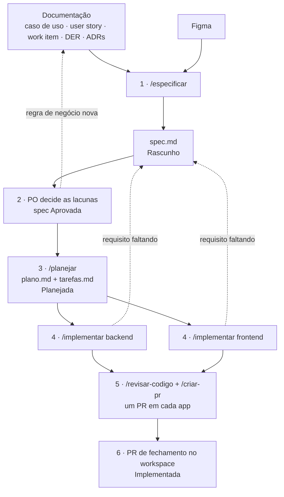

# Specs — desenvolvimento orientado a especificação (SDD)

Uma spec é o combinado de **uma user story** (`CCDnnn`) antes de virar código: o que fazer, como e em que ordem.
Ela não inventa requisito. Junta num lugar só, com IDs fixos, o que já está no caso de uso, na user story, no work
item, no DER e no Figma, e acrescenta o que falta para implementar e conferir: critérios de aceite, contrato da API
e tarefas (ADR-047).

Hierarquia das fontes: **documentação** (casos de uso, user stories, DER, ADRs) → **spec** → **código**. O Figma
manda no visual; quando diverge da documentação, vale a documentação.

As specs ficam aqui, fora de `docs/`, porque `docs/` é a fonte da verdade e só guarda documentação. A spec é
derivada dela e muda de status e de progresso ao longo do trabalho.

## Fluxo



| Passo | Quem | Como | Sai | Status |
|---|---|---|---|---|
| 1. Especificar | quem pegou a user story | `/especificar CCDnnn [link do frame]` | `spec.md` com requisitos, critérios de aceite, telas e lacunas | `Rascunho` |
| 2. Aprovar | PO | revisa o PR da spec e decide as lacunas | lacunas decididas; caso de uso atualizado se a regra mudou | `Aprovada` |
| 3. Planejar | devs do back e do front, juntos | `/planejar CCDnnn` | `plano.md` (contrato da API) e `tarefas.md`; Tasks no Azure, se quiser | `Planejada` |
| 4. Implementar | dev de cada app, em paralelo | `/implementar CCDnnn backend` · `… frontend` | código e testes na branch de feature de cada app | `Em implementação` |
| 5. Revisar e abrir o PR | quem implementou | `/revisar-codigo` · `/criar-pr` | um PR em cada app, citando os requisitos | — |
| 6. Fechar | quem implementou | `/criar-pr workspace` | ponteiros `apps/*` atualizados e tarefas marcadas | `Implementada` |

### 1. Especificar — `/especificar CCDnnn [link do frame]`

- **Entra:** o código do caso de uso (`CCD014`) ou o work item (`#120`). O link do frame é opcional: sem ele, a
  skill procura a tela no índice do `/analisar-figma-chrome`.
- **O que acontece:**
  1. O agent `analista-requisitos` lê o caso de uso, a user story, o work item no Azure, o DER e os ADRs que mudam a
     regra. Ele devolve os requisitos (`R1`, `R2`…), cada um com a origem (`14-marcar-carta-como-possuo.md, FP 3`).
  2. O agent `leitor-figma` abre as telas no Chrome, no modo protótipo, e faz o inventário delas. Não gasta a cota do
     MCP do Figma.
  3. A skill cruza os dois e grava o `spec.md`: requisitos, critérios de aceite (`CA1`… em Dado/quando/então), dados
     do DER, telas com o veredito, o que fica fora do escopo e as lacunas (`L1`…).
- **Sai:** a spec em `Rascunho`, a linha no índice, a lista de lacunas para o PO e as divergências do Figma para o
  designer.
- **Git:** branch `docs/<id>-spec-<descricao>` no workspace, commit `docs(specs): especifica CCDnnn <nome>` com
  `AB#<id>` e PR para `development`.

### 2. Aprovar — PO

- O PO lê a spec no PR do workspace e responde cada lacuna.
- **Regra de negócio** decidida (ex.: "pode marcar Possuo com quantidade zero?"): o caso de uso é atualizado no mesmo
  PR, e o requisito passa a citar o passo novo. **Decisão técnica:** vira ADR `Proposto`.
- **Figma errado** não bloqueia a aprovação: vale a documentação, e o designer corrige a tela.
- Quando não sobra lacuna `pendente`, avise o Claude ("o PO aprovou a spec do CCD014"). A spec fica `Aprovada`, com
  a data e quem aprovou. O Claude nunca aprova sozinho.

### 3. Planejar — `/planejar CCDnnn`

- **Entra:** a spec `Aprovada`. Em `Rascunho`, a skill para e mostra o que falta.
- **O que acontece:** a skill lê o DBML e o `schema.prisma` para achar as tabelas que ainda não têm migration. Lê
  também o domínio e a feature do código, os modelos `users` dos dois apps, as outras specs (dependências) e os ADRs.
  Com isso escreve:
  - `plano.md`: tabelas e migrations, **contrato da API** (endpoint, acesso, entrada, resposta e erros, no padrão do
    ADR-011), arquivos do backend e do frontend, e um teste para cada `CA`;
  - `tarefas.md`: tarefas `T1`… em ordem, separadas por app, cada uma com os requisitos que cobre e um "Pronto quando".
- **Azure:** a skill oferece criar as tarefas como Tasks filhas da user story, com confirmação, e grava o `AB#` de
  cada uma no `tarefas.md`.
- **Sai:** a spec `Planejada`. O contrato da API é o combinado entre quem faz o back e quem faz o front; ele é revisado
  no PR do workspace (o mesmo da spec ou outro).

### 4. Implementar — `/implementar CCDnnn backend` e `/implementar CCDnnn frontend`

- **Entra:** a spec `Planejada`. O frontend não precisa esperar o backend: ele segue o contrato do plano.
- **O que acontece:** no app, a skill cria `feature/<id>-<descricao>` a partir de `develop` e faz as tarefas daquele
  app em ordem. Em cada tarefa ela copia o padrão do modelo `users`, implementa só o que a tarefa diz, escreve os
  testes com o ID do critério no nome (`CA2: recusa senha incorreta com 401`), roda lint, typecheck e testes, e marca
  `[x]`. Se você autorizar no começo, ela commita ao fim de cada tarefa (`feat(<dominio>): … AB#<task>`).
- **Para quando:** o plano não funciona como escrito, falta um requisito ou é preciso uma decisão de arquitetura (veja
  [Quando algo não bate](#quando-algo-não-bate)).
- **Sai:** a branch com as tarefas feitas, as checagens completas do app passando e a cobertura de cada requisito. A
  spec fica `Em implementação`.

### 5. Revisar e abrir o PR — `/revisar-codigo` e `/criar-pr`

- `/revisar-codigo` revisa em dois eixos. **Padrões:** ADRs, rules, Clean Code, SOLID e Object Calisthenics.
  **Spec:** cada `R` como feito, parcial ou não feito, e o contrato da API do plano comparado com o diff.
- `/criar-pr` roda as checagens, faz push e abre o PR no app para `develop`, com o `AB#` e a seção **Spec**
  (requisitos e tarefas que o PR cobre).
- Merge com 1 aprovação de outra pessoa e o CI verde, em squash (`.claude/rules/git.md`).

### 6. Fechar — PR do workspace

Depois do merge dos PRs dos apps, um PR no workspace (`/criar-pr workspace`) leva:

- os ponteiros dos submódulos (`git add apps/cromocard-backend apps/cromocard-frontend`);
- as tarefas marcadas no `tarefas.md` e a tarefa de fechamento;
- a spec `Implementada` e a linha do índice atualizada.

### Quando algo não bate

| Situação | Onde se resolve | O que fazer |
|---|---|---|
| A documentação não diz algo | Lacuna `L<n>` na spec | O PO decide; regra de negócio vai para o caso de uso |
| O Figma diverge da documentação | Seção **Telas** da spec | Implementar como a documentação pede; o designer corrige a tela |
| O caso de uso, a user story ou o DER mudou depois da aprovação | Spec volta para `Rascunho` | `/especificar` atualiza, o PO aprova de novo e o `/planejar` revê o plano |
| Na implementação, o contrato ou um arquivo do plano não funciona | `plano.md` | Propor a mudança, combinar com quem faz o outro app e só então seguir |
| Na implementação, falta um requisito ou um contradiz outro | Spec volta para `Rascunho` | Parar a implementação nesse ponto e levar a lacuna ao PO |
| Precisa de uma decisão de arquitetura | ADR novo `Proposto` | Citar o ADR em **Decisões técnicas** do plano |
| O DER precisa de tabela ou coluna nova | PR de docs no DER, antes do plano | Mudar os três formatos (`.claude/rules/modelagem-de-dados.md`) |

### Exemplo

```
/especificar CCD014                     → specs/CCD014-marcar-carta-como-possuo/spec.md (Rascunho, L1 e L2)
/criar-pr workspace                     → PR "docs(specs): especifica CCD014 marcar carta como possuo"
(PO decide L1 e L2 no PR)               → caso de uso 14 atualizado no mesmo PR
"o PO aprovou a spec do CCD014"         → spec Aprovada
/planejar CCD014                        → plano.md + tarefas.md (T1–T8), Tasks criadas no Azure
/implementar CCD014 backend             → feature/120-marcar-carta-possuo no backend, T1–T4
/implementar CCD014 frontend            → feature/120-marcar-carta-possuo no frontend, T5–T7
/revisar-codigo backend · /criar-pr backend     (e o mesmo no frontend)
/criar-pr workspace                     → ponteiros apps/*, T8 marcada, spec Implementada
```

## Estrutura

```
specs/
├── README.md                       fluxo e índice (este arquivo)
├── template/                       modelos de spec.md, plano.md e tarefas.md
└── CCD004-realizar-login/
    ├── spec.md       o quê: requisitos, critérios de aceite, dados, telas, fora do escopo, lacunas
    ├── plano.md      como: dados, contrato da API, backend, frontend, testes
    └── tarefas.md    em que ordem: tarefas por repositório, com os requisitos cobertos e o AB#
```

Nome da pasta: `CCDnnn-` + o nome do arquivo do caso de uso sem o número (`14-marcar-carta-como-possuo.md` →
`CCD014-marcar-carta-como-possuo`). Formato e regras: `.claude/rules/specs.md`.

## Status

`Rascunho` · `Aprovada` · `Planejada` · `Em implementação` · `Implementada` · `Cancelada`

- Toda spec nasce `Rascunho` e só vira `Aprovada` com a validação do PO, sem lacuna pendente.
- Se a documentação da user story mudar depois de aprovada, a spec volta para `Rascunho`.

## Índice

| CCD | User story | Fase | Status | Work item |
|---|---|---|---|---|
| [CCD003](CCD003-criar-conta/spec.md) | Criar Conta | MVP | Planejada | #108 |
| [CCD004](CCD004-realizar-login/spec.md) | Realizar Login | MVP | Planejada | #109 |
| [CCD006](CCD006-recuperar-senha/spec.md) | Recuperar Senha | MVP | Planejada | #111 |
| [CCD058](CCD058-visualizar-dashboard-gerencial/spec.md) | Visualizar Dashboard Gerencial | MVP | Planejada | #333 |
| [CCD059](CCD059-gestao-de-usuarios/spec.md) | Gestão de Usuários | MVP | Planejada | #334 |
| [CCD060](CCD060-disparar-notificacao-global/spec.md) | Disparar Notificação Global | MVP | Planejada | #335 |
| [CCD061](CCD061-gestao-de-catalogo/spec.md) | Gestão de Catálogo | MVP | Planejada | #336 |
| [CCD062](CCD062-gestao-de-comunidade/spec.md) | Gestão de Comunidade | MVP | Planejada | #337 |
| [CCD063](CCD063-exportar-relatorios-gerenciais/spec.md) | Exportar Relatórios Gerenciais | MVP | Planejada | #338 |
| [CCD064](CCD064-aprovar-solicitacoes/spec.md) | Aprovar Solicitações | MVP | Planejada | #339 |
| [CCD065](CCD065-log-de-auditoria-admin/spec.md) | Log de Auditoria Admin | MVP | Planejada | #340 |
| [CCD066](CCD066-configuracoes-globais/spec.md) | Configurações Globais | MVP | Planejada | #341 |
| [Fundação](fundacao-backoffice/plano.md) | Fundação técnica do Painel Administrador | MVP | Em implementação (técnica, sem spec) | #481 |
| [CCD094](CCD094-validar-cadastro-de-vendedor/spec.md) | Validar Cadastro de Vendedor | Escopo Adicional | Planejada | #598 |
| [CCD095](CCD095-notificar-pendencia-cadastral/spec.md) | Notificar Pendência Cadastral | Escopo Adicional | Planejada | #599 |
| [CCD096](CCD096-acompanhar-evolucao-de-cadastros/spec.md) | Acompanhar Evolução de Cadastros | Escopo Adicional | Planejada | #600 |
| [CCD097](CCD097-visualizar-indicadores-financeiros/spec.md) | Visualizar Indicadores Financeiros | Escopo Adicional | Planejada | #601 |
| [CCD098](CCD098-gerenciar-dados-complementares-do-usuario/spec.md) | Gerenciar Dados Complementares do Usuário | Escopo Adicional | Planejada | #602 |
| [CCD099](CCD099-aplicar-sancao-a-usuario/spec.md) | Aplicar Sanção a Usuário | Escopo Adicional | Planejada | #603 |
| [CCD100](CCD100-agendar-notificacao-global/spec.md) | Agendar Notificação Global | Escopo Adicional | Planejada | #604 |
| [CCD101](CCD101-segmentar-notificacao-global/spec.md) | Segmentar Notificação Global | Escopo Adicional | Planejada | #605 |
| [CCD102](CCD102-exportar-log-de-auditoria/spec.md) | Exportar Log de Auditoria | Escopo Adicional | Planejada | #606 |
| [CCD103](CCD103-votar-em-solicitacao-de-catalogo/spec.md) | Votar em Solicitação de Catálogo | Escopo Adicional | Planejada | #607 |
| [CCD104](CCD104-ordenar-categorias-padrao/spec.md) | Ordenar Categorias Padrão | Escopo Adicional | Planejada | #608 |
| [CCD105](CCD105-duplicar-carta/spec.md) | Duplicar Carta | Escopo Adicional | Planejada | #609 |
| [CCD106](CCD106-salvar-rascunho-de-carta/spec.md) | Salvar Rascunho de Carta | Escopo Adicional | Planejada | #610 |
| [CCD107](CCD107-consultar-historico-de-relatorios/spec.md) | Consultar Histórico de Relatórios | Escopo Adicional | Planejada | #611 |
